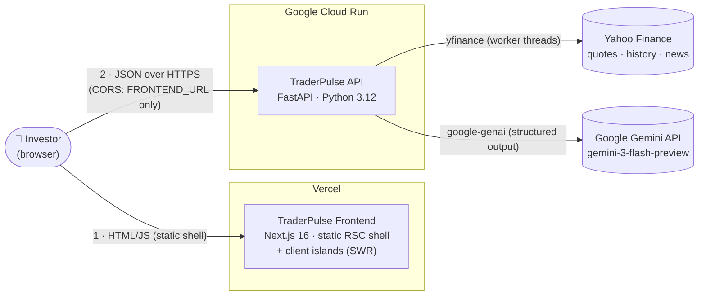
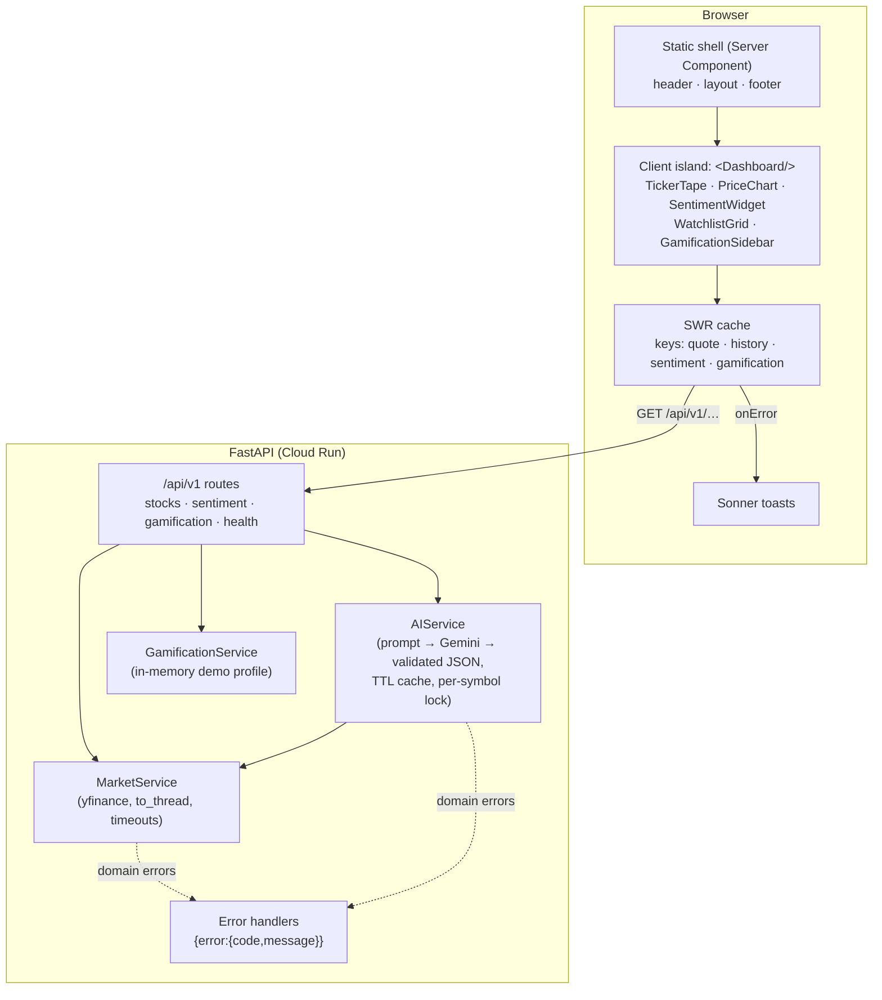
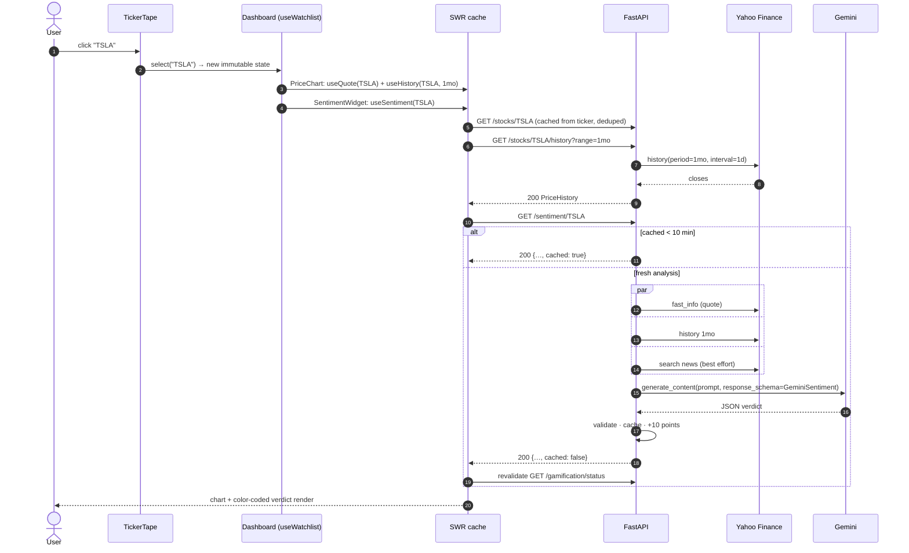
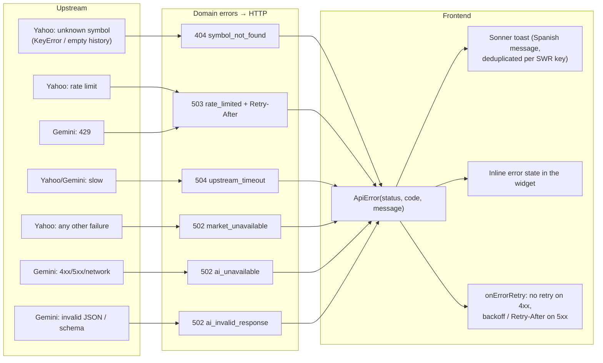
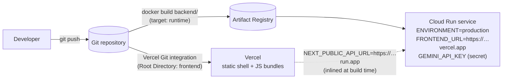

# TraderPulse: System Architecture

This document describes TraderPulse **as a system**: how the two apps and the external providers fit together, how a request flows end to end, and the cross-cutting decisions behind them. Each app's internals are covered in its own architecture guide:

- [backend/ARCHITECTURE.md](backend/ARCHITECTURE.md): layers, error mapping, sentiment pipeline, caching.
- [frontend/ARCHITECTURE.md](frontend/ARCHITECTURE.md): RSC shell, client islands, SWR data flow, state.

---

## 1. System context

Two independently deployed apps:

| App | Runs on | Responsibility |
|---|---|---|
| **Frontend** | Vercel (static and edge-cached) | Renders the dashboard. All live data is fetched **from the browser** with SWR. |
| **Backend** | Cloud Run (container) | The only component that talks to Yahoo Finance and Gemini. It holds the API key and maps upstream failures to HTTP errors. |

The browser calls the API **directly** (`NEXT_PUBLIC_API_URL`). This is why the backend enforces a strict CORS allow-list. See [ADR-002](#adr-002-browser-calls-the-api-directly-strict-cors).

## 2. Containers and responsibilities

## 3. End-to-end flow: clicking a ticker

## 4. Error propagation

## 5. Data freshness

| Data | Source | Frontend refresh | Backend cache |
|---|---|---|---|
| Quote | `Ticker.fast_info` | every 60s (`NEXT_PUBLIC_POLL_INTERVAL_MS`) | none |
| Intraday history (1D, 5D) | `Ticker.history` | every 60s | none |
| Long history (1M, 6M, 1A) | `Ticker.history` | every 5 min | none |
| Sentiment | Gemini + quote, history and news | **not polled**: runs on symbol change or "Reanalizar" | 10 min TTL (successes only) |
| Gamification | in-memory store | every 60s, plus after each fresh analysis | n/a |

## 6. Security model

- **Secrets stay server-side.** `GEMINI_API_KEY` exists only in the backend's environment (Cloud Run env or Secret Manager), as a `SecretStr` that is never logged or serialized. The frontend env contains only `NEXT_PUBLIC_*` values, which are public by definition.
- **CORS is strict.** In production the allow-list is exactly `FRONTEND_URL` (normalized to its origin), with `GET` only and no credentials. Development additionally allows `localhost:3000` and `127.0.0.1:3000`.
- **Input validation.** Symbols are validated by regex, and query parameters by FastAPI and Pydantic (`range` is a `Literal`).
- **No user data.** There is no authentication and no PII. The gamification profile is a single demo user in memory.
- **Docs are hidden in production.** `/docs` and `/openapi.json` are disabled when `ENVIRONMENT=production`.

## 7. Deployment topology

Deploy the backend first, because the frontend needs its URL at build time. Then set `FRONTEND_URL` on Cloud Run to the Vercel production URL. Step-by-step instructions are in [backend/ONBOARDING.md → Deploying](backend/ONBOARDING.md#8-deploying-to-google-cloud-run) and [frontend/ONBOARDING.md → Deploying](frontend/ONBOARDING.md#8-deploying-to-vercel). The live environment, redeploy commands and smoke tests are in [docs/DEPLOYMENT.md](docs/DEPLOYMENT.md).

---

## 8. Key Architectural Decisions (cross-cutting ADRs)

App-specific ADRs, such as *Why FastAPI?* and *Why SWR?*, live in the spoke architecture docs. These are the decisions that shape **both** apps.

### ADR-001: Decoupled frontend and backend

**Decision.** There are two independent apps, with their own dependencies, tests, linters, Dockerfiles and deploy targets.
**Why.**
- Each half uses the best runtime for its job. Python has first-class finance and AI SDKs (`yfinance`, `google-genai`), and Next.js gives Vercel a fast static shell.
- They scale and release independently, so a prompt tweak redeploys only Cloud Run.
- Secrets stay isolated in the backend.

**Trade-off.** There are two pipelines and a contract to keep in sync. The shared error envelope and the mirrored Zod schemas make that contract explicit and testable.

### ADR-002: Browser calls the API directly (strict CORS)

**Decision.** Client components fetch `NEXT_PUBLIC_API_URL` directly. The backend is the only CORS-enabled origin, and it allows `FRONTEND_URL` exclusively.
**Why.**
- Real-time polling from many widgets is cheapest as direct browser→API traffic. It avoids a Vercel function invocation per poll and an extra network hop.
- The frontend can then be fully static (`○ /` in the build output).
- CORS becomes a real, tested boundary rather than an unused setting.

**Alternatives considered.** A BFF: Next.js route handlers or Server Actions proxying to FastAPI. It would hide the API URL and let us add server-side auth later, but it costs a hop and server compute on every 60s poll. If TraderPulse adds user accounts, revisit this and put authenticated calls behind a BFF.

### ADR-003: No mock or fallback data for market & AI

**Decision.** If Yahoo Finance or Gemini fails, or a symbol doesn't exist, the API returns the corresponding HTTP error **immediately**. It never returns stale, synthetic or default values. The frontend surfaces every error with a Sonner toast.
**Why.** In a financial tool, a plausible but fake number is worse than an error: users can act on it. Explicit errors are also debuggable and observable.
**Nuances (still compliant):**
- The **sentiment cache** reuses a *real, successful* analysis for up to 10 minutes, labeled `cached: true` and "En caché" in the UI. Failures are never cached.
- **Headlines are best effort.** If the news lookup fails, the analysis proceeds on real price data, and `headlines: []` shows exactly what was used. The quote and history remain mandatory.
- **Gamification** is the one explicitly mocked layer (an in-memory demo profile), as the spec allows.

### ADR-004: Gemini 3 Flash with structured output

**Decision.** Use `gemini-3-flash-preview` by default, configurable via `GEMINI_MODEL`. Request `response_mime_type="application/json"` with a Pydantic `response_schema`, then re-validate locally.
**Why.**
- Flash-class models are fast and cheap enough for interactive use.
- Structured output removes brittle text parsing, and local validation guarantees the API contract even if the model drifts.
- A low thinking level keeps latency down for a short classification task.

**Risk.** It is a **Preview** model, which Google may retire on short notice. Mitigation: switch to the stable `gemini-3.8-flash` (or newer) by changing one env var, with no code change.

### ADR-005: Validate configuration at startup on both sides

**Decision.**
- **Backend:** Pydantic Settings validates `GEMINI_API_KEY` (required, non-blank), `FRONTEND_URL` (URL, https in production), `PORT` and timeouts before uvicorn binds. Invalid configuration exits with code 1.
- **Frontend:** Zod validates `NEXT_PUBLIC_API_URL` and `NEXT_PUBLIC_POLL_INTERVAL_MS` from `next.config.ts`, so `next dev` and `next build` fail on bad values.

**Why.** Configuration bugs should fail the deploy, not the user. Cloud Run keeps serving the previous healthy revision when a new one can't boot, and Vercel never promotes a failed build. `NEXT_PUBLIC_*` values are frozen into the bundle at build time, which makes build-time validation the only place to catch them.

### ADR-006: One error envelope, Spanish messages from the server

**Decision.** All errors use `{"error": {"code", "message"}}`, where `message` is already Spanish UI copy.
**Why.** There is a single source of truth for user-facing copy per failure, and new error types appear correctly in the UI without a frontend release. The frontend keeps `FALLBACK_MESSAGES` only for non-envelope failures, such as network errors or proxy HTML pages.
