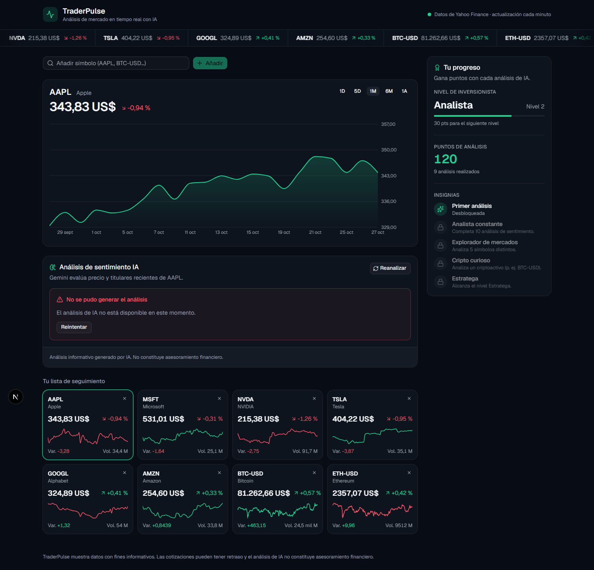

# TraderPulse

**TraderPulse** is a dark-themed SaaS dashboard for real-time market analysis. It streams quotes from **Yahoo Finance**, charts price trends, and asks **Gemini 3 Flash** for an AI sentiment verdict (Alcista / Bajista / Neutral) with a short justification in Spanish. Analysis points and badges add a light gamification layer.



> The UI and every user-facing message are in **Spanish**. Code, identifiers, comments and all documentation are in **English**.

## 🌐 Live

| | URL |
|---|---|
| **App** (Vercel) | https://traderpulse-ten.vercel.app |
| **API** (Cloud Run, `northamerica-south1`) | https://traderpulse-api-549697455926.northamerica-south1.run.app |
| API health check | https://traderpulse-api-549697455926.northamerica-south1.run.app/api/v1/health |

The API's bare URL returns a small JSON index (name, version, health link). All other routes live under `/api/v1/`, and `/docs` is disabled in production. Redeploy steps and smoke tests are in [docs/DEPLOYMENT.md](docs/DEPLOYMENT.md).

---

## 📚 Documentation map (Hub & Spoke)

| Start here | What it covers |
|---|---|
| **[ONBOARDING.md](ONBOARDING.md)** | The hub. Prerequisites, a 5-minute quick start, shared conventions, and links to every guide. |
| **[ARCHITECTURE.md](ARCHITECTURE.md)** | System-level flow, Mermaid diagrams, and cross-cutting decision records (ADRs). |
| **[docs/DEPLOYMENT.md](docs/DEPLOYMENT.md)** | Production environment, redeploy and key-rotation steps, smoke tests. |

| | Backend (FastAPI) | Frontend (Next.js) |
|---|---|---|
| Overview & reference | [backend/README.md](backend/README.md): features, **API reference**, configuration | [docs/frontend/README.md](docs/frontend/README.md): features, **component library**, hooks |
| How to work on it | [backend/ONBOARDING.md](backend/ONBOARDING.md): structure deep dive, workflows, debugging | [docs/frontend/ONBOARDING.md](docs/frontend/ONBOARDING.md): structure deep dive, workflows, debugging |
| How it is built | [backend/ARCHITECTURE.md](backend/ARCHITECTURE.md): layers, error mapping, ADRs | [docs/frontend/ARCHITECTURE.md](docs/frontend/ARCHITECTURE.md): RSC shell, SWR data flow, ADRs |

---

## ✨ Features

- **Live ticker tape.** An infinite marquee of quotes that pauses on hover. Clicking a symbol retargets the main chart and the AI widget.
- **Watchlist grid.** One card per stock or crypto asset, showing price, daily change, volume and a 5-day sparkline. Add any Yahoo symbol (`AAPL`, `BTC-USD`, `EURUSD=X`, `^GSPC`) or remove one.
- **Price charts.** Recharts area chart with 1D / 5D / 1M / 6M / 1A ranges. The line turns green or red with the period's trend.
- **AI sentiment widget.** Gemini combines real price action with recent headlines and returns a validated, structured verdict: sentiment, confidence, justification and key factors. Results are color-coded and list their sources. "Reanalizar" forces a fresh analysis.
- **Gamification.** The sidebar shows "Nivel de Inversionista" with a progress bar, "Puntos de Análisis" and badges. Selecting a stock credits +10 points optimistically, confirmed by the server for every fresh analysis, with a "¡XP ganada!" toast. Five analyses unlock "Experto en Mercado Alcista".
- **Honest errors.** There is no mock or fallback market or AI data. Failures become precise HTTP errors (404, 502, 503, 504) that the UI shows as **Sonner** toasts in Spanish.
- **Real-time polling.** SWR polls quotes every 60s and deduplicates requests across components.
- **Fail-fast configuration.** **Pydantic Settings** refuses to start the backend without `GEMINI_API_KEY`, and **Zod** fails the frontend build without `NEXT_PUBLIC_API_URL`.

## 🧱 Stack

| Layer | Technology |
|---|---|
| Frontend | Next.js 16 (App Router, React 19, Cache Components), Tailwind CSS v4, shadcn/ui (Base UI), Lucide React, SWR, Sonner, Recharts, Zod |
| Backend | Python 3.12, FastAPI, Uvicorn, Pydantic v2 + pydantic-settings (python-dotenv), yfinance, google-genai |
| AI | Gemini 3 Flash (`gemini-3-flash-preview`) with structured JSON output |
| Quality | Ruff (backend lint and format), ESLint + Prettier (frontend), Pytest + httpx, Vitest + React Testing Library |
| Delivery | Cloud Build → Artifact Registry → Google Cloud Run with the Gemini key in Secret Manager (backend), Vercel (frontend), docker-compose for local development |

## 🗂️ Repository layout

The Next.js frontend lives at the repository root (the standard `create-next-app` layout, entry point `src/app/page.tsx`), and the FastAPI backend lives in `backend/`.

```
trader-pulse/
├── README.md · ONBOARDING.md · ARCHITECTURE.md   ← hub docs
├── package.json · next.config.ts · tsconfig.json ← Next.js app (frontend) at the root
├── src/{app,components,hooks,lib}/              ← frontend source (see docs/frontend/README.md)
├── src/__tests__/                               ← Vitest suites
├── Dockerfile.frontend                          ← dev-only frontend image for docker-compose
├── docker-compose.yml                           ← local dev, both services with hot reload
├── .vscode/launch.json                          ← debug configs (backend, frontend, tests, full stack)
├── docs/DEPLOYMENT.md                           ← production runbook and smoke tests
├── docs/frontend/                               ← frontend README, onboarding, architecture
├── docs/images/                                 ← screenshots used by the docs
└── backend/                                     ← FastAPI service (see backend/README.md)
    ├── app/{core,api,services,schemas}/
    ├── tests/
    ├── Dockerfile                               ← builder / dev / runtime (Cloud Run)
    └── cloudbuild.yaml                          ← Cloud Build → Artifact Registry
```

## 🚀 Quick start

You need a Gemini API key from [Google AI Studio](https://aistudio.google.com/apikey).

**With Docker:**

```bash
cp backend/.env.example backend/.env    # then set GEMINI_API_KEY
docker compose up --build
```

**Without Docker** (uv + Node 24):

```bash
# terminal 1
cd backend && cp .env.example .env && uv sync && uv run python -m app
# terminal 2 (repo root)
cp .env.example .env.local && npm install && npm run dev
```

Then open **http://localhost:3000**. The API docs are at http://localhost:8080/docs. The full walkthrough is in [ONBOARDING.md](ONBOARDING.md).

## ✅ Quality gates

```bash
# backend/
uv run ruff check . && uv run ruff format --check . && uv run pytest

# repo root (frontend)
npm run lint && npm run format:check && npm run typecheck && npm test && npm run build
```

## ⚠️ Disclaimer

TraderPulse is for informational purposes only. Yahoo Finance quotes may be delayed, and AI-generated analysis is **not financial advice**.
