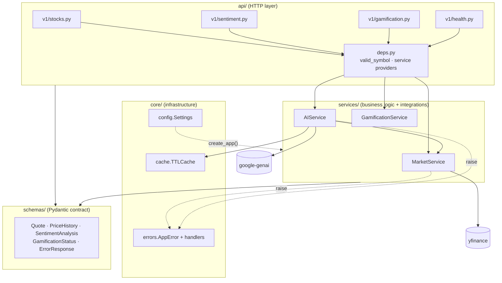
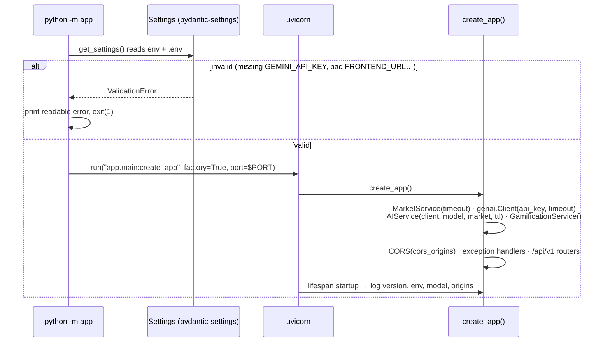
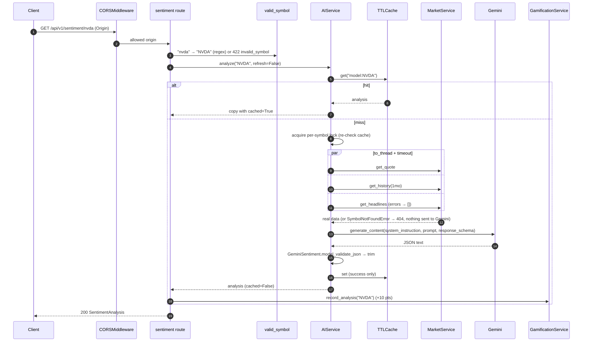
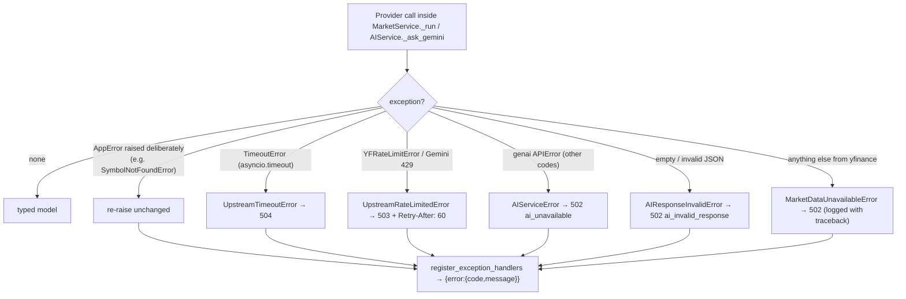

# Backend Architecture: TraderPulse API

How the FastAPI service is structured internally, how a request moves through it, and why it is built this way. For the system-wide picture see the [root ARCHITECTURE.md](../ARCHITECTURE.md).

← [Hub](../ONBOARDING.md) · [Backend README](README.md) · [Backend onboarding](ONBOARDING.md)

---

## 1. Layers

**Dependency rule.** `api → services → core/schemas`, never the reverse. Services don't import FastAPI. They raise `AppError` subclasses, which `core/errors.py` turns into HTTP responses. Because services are framework-agnostic, they can be unit-tested without a web server and reused from scripts or jobs.

## 2. Application startup

## 3. Request lifecycle: `GET /api/v1/sentiment/{symbol}`

## 4. Error mapping

How "not found" is detected:

| Signal from yfinance | Interpretation |
|---|---|
| `fast_info["last_price"]` raises `KeyError` | Unknown symbol (yfinance raises `KeyError('currentTradingPeriod')`) |
| `last_price` is `None`, NaN or non-numeric | Delisted or no market data |
| `history(..., raise_errors=True)` raises `YFPricesMissingError`, `YFTickerMissingError` or `YFTzMissingError` | Unknown symbol |
| Empty history frame, or every close is NaN | No data for that range |

## 5. Concurrency model

- **Event loop.** Uvicorn runs a single asyncio loop per process. Routes are `async def`.
- **Blocking yfinance.** `MarketService._run` executes the sync worker in the default thread pool (`asyncio.to_thread`), wrapped in `asyncio.timeout(UPSTREAM_TIMEOUT_SECONDS)`. On a timeout the request fails fast with 504. The worker thread may finish in the background, and its result is discarded.
- **Gemini.** Native async through `client.aio.models.generate_content`. It has two timeouts: `HttpOptions(timeout=…)` at the HTTP layer and `asyncio.timeout` as a hard upper bound.
- **Parallel fan-out.** A fresh sentiment analysis fetches the quote, history and headlines concurrently with `asyncio.gather`.
- **Stampede protection.** `AIService` keeps an `asyncio.Lock` per `model:symbol`. N simultaneous requests for an uncached symbol produce **one** Gemini call: the first computes, and the others wait and then read the cache.
- **Shared state.** `TTLCache` is touched only from the event loop and never awaits, so it needs no lock. `GamificationService` mutates under an `asyncio.Lock`.

## 6. Sentiment cache

| Property | Value |
|---|---|
| Key | `f"{model}:{symbol}"`, so a model change never serves another model's output |
| Stored | Successful `SentimentAnalysis` only |
| TTL | `SENTIMENT_CACHE_TTL_SECONDS` (600 s by default; 0 disables it) |
| Eviction | LRU beyond 256 entries |
| Bypass | `?refresh=true` |
| Visibility | `cached: true` in the response, and "En caché" in the UI |
| Scope | Per process / Cloud Run instance; lost on restart |

---

## 7. Key Architectural Decisions (backend ADRs)

### ADR-B1: Why FastAPI?

- **Async-first.** Concurrent fan-out to Yahoo and Gemini without blocking, and native `async` routes.
- **Pydantic v2 at the core.** Response models *are* the API contract: validated output, an auto-generated OpenAPI spec at `/docs`, and type hints that serve as documentation.
- **Dependency injection** (`Depends`) lets routes declare what they need (validated symbol, services), which keeps them thin and testable.
- **Ecosystem fit.** Python is where `yfinance` and Google's `google-genai` SDK live.

*Alternatives:* Flask (sync, no built-in validation or OpenAPI) and Django REST (heavyweight for a stateless API). A Node backend would lose `yfinance`.

### ADR-B2: Why uv?

There is one tool for the interpreter (`.python-version`), the virtualenv, dependency resolution and a cross-platform lockfile. It is 10–100× faster than pip, and `uv sync --frozen` makes Docker builds reproducible. The same lockfile serves local development, CI and the container.

### ADR-B3: Pydantic Settings for configuration

Settings are typed, validated and documented in one class, and secrets are `SecretStr`. The process refuses to start without `GEMINI_API_KEY`, which turns a runtime 502 into a deploy-time failure. pydantic-settings reads `.env` through **python-dotenv**, while real environment variables, such as Cloud Run's, take precedence. That gives one mechanism for local development and production.

### ADR-B4: Services with injected provider factories

`MarketService(ticker_factory=yf.Ticker, search_factory=yf.Search)` and `AIService(client=genai.Client(...))` receive their providers instead of importing them inline.
**Why.** Tests replace *only* the provider boundary and exercise the real service code: thread offloading, timeouts, parsing and error translation. That catches far more than mocking whole services. `create_app(..., market_service=…, ai_service=…)` extends the same idea to the HTTP tests.

### ADR-B5: `asyncio.to_thread` for yfinance (instead of an async HTTP client)

yfinance is synchronous and encapsulates Yahoo's undocumented endpoints, cookies and crumbs. Re-implementing it asynchronously would be brittle. Offloading to threads keeps the loop responsive. The thread pool bounds concurrency, and `asyncio.timeout` bounds latency.

### ADR-B6: Gemini structured output + local validation

The response schema is enforced by Gemini (`response_schema=GeminiSentiment`) **and** re-validated locally with `model_validate_json`. Validators trim the justification to 400 characters and keep at most 3 factors.
**Why.** There is no regex parsing of free text, and the API contract holds even if the model misbehaves (that case becomes `502 ai_invalid_response`). We use the default temperature, as recommended for Gemini 3, with `thinking_level=LOW` for latency.

### ADR-B7: In-memory gamification store

The spec asks for mock persistence for points only. A small class with a clear interface (`record_analysis`, `status`) keeps that mock isolated, so swapping in Firestore or Postgres later means replacing one class.
**Known limits.** Data resets on restart and is per instance, which is acceptable for a demo user and documented in the API reference.

### ADR-B8: Headlines from `yf.Search` and treated as best effort

`Ticker.news` currently calls a Yahoo endpoint that answers 404, and yfinance silently returns `[]`. The search API returns the same articles reliably, so we use it and parse both known news shapes (flat and nested `content`).
Headlines **enrich** the analysis but are not essential. If the lookup fails, we analyze real price data and return `headlines: []`. This is not fallback data: the response states exactly what the model saw.

### ADR-B9: Single error envelope with Spanish messages

Domain exceptions carry `status_code`, `code` and a Spanish `message`, and global handlers render them, along with FastAPI and Starlette errors, in one shape. Routes never build error responses, and the frontend can toast `message` directly.
