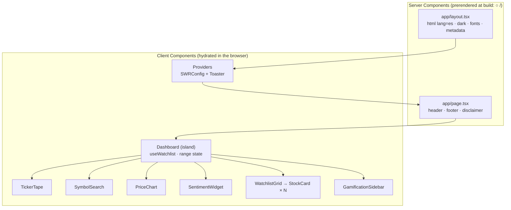
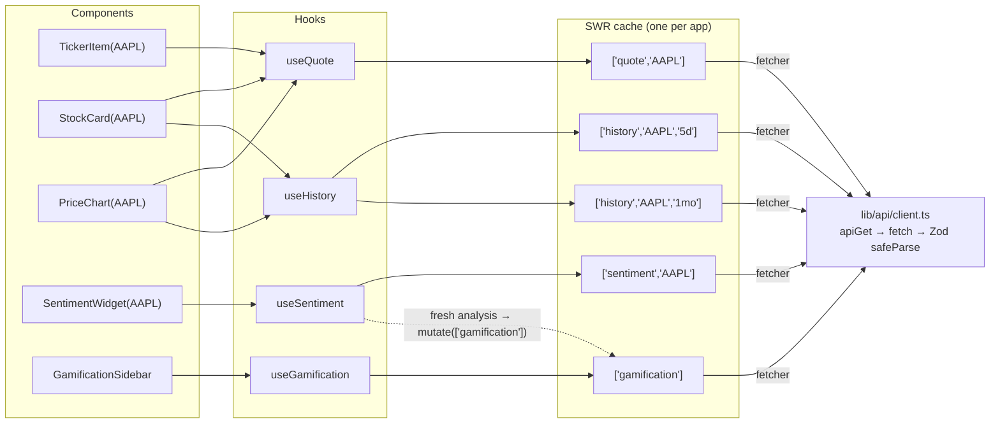
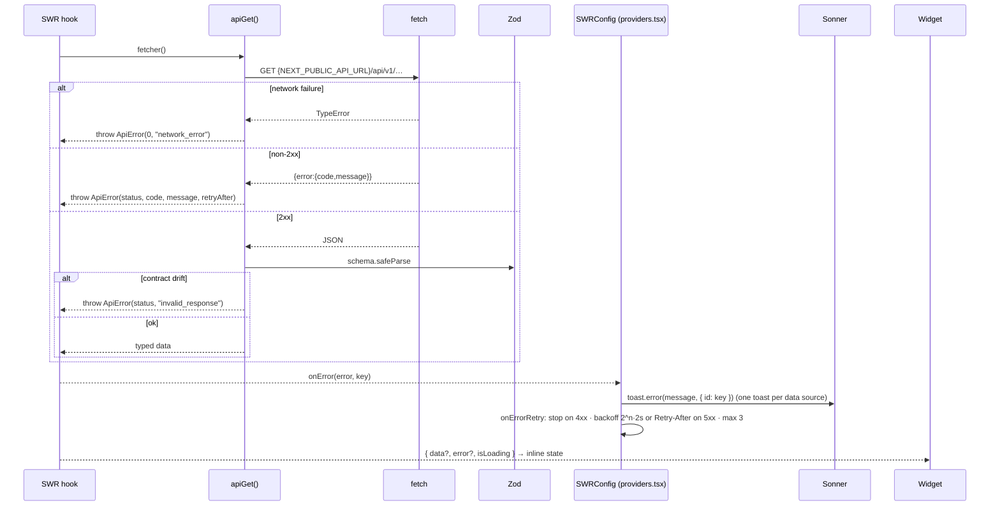
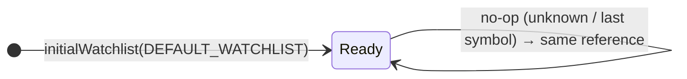
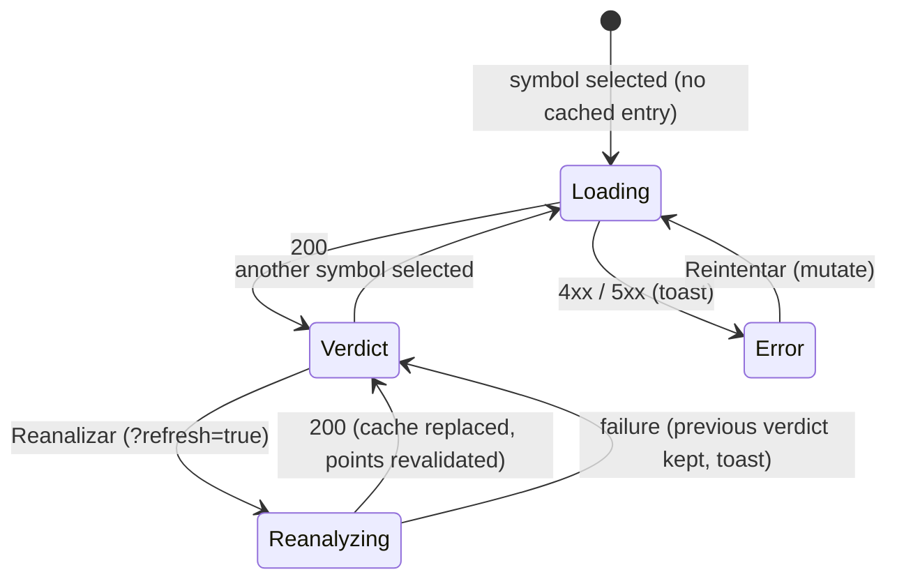

# Frontend Architecture: TraderPulse Dashboard

How the Next.js app is put together: rendering model, data flow, state, error handling and styling, plus the decisions behind them. For the system-wide view see the [root ARCHITECTURE.md](../ARCHITECTURE.md).

← [Hub](../ONBOARDING.md) · [Frontend README](README.md) · [Frontend onboarding](ONBOARDING.md)

---

## 1. Rendering model: static RSC shell + one client island

- The route `/` is **fully static** (`○` in `next build`). The HTML shell, including loading skeletons, is served from Vercel's CDN with no server compute.
- `cacheComponents` is enabled (the Next 16 default for new apps). The page never reads request data or calls the backend on the server, so no `Suspense` or `connection()` is needed.
- All live data is fetched **in the browser** by SWR hooks inside the `Dashboard` island, which calls the API directly. See [root ADR-002](../ARCHITECTURE.md#adr-002-browser-calls-the-api-directly-strict-cors).

## 2. Data flow

**Deduplication.** The ticker item, the stock card and the chart all read `['quote','AAPL']`, which produces **one** request per poll interval, not three.

| Hook              | Refresh policy                                          | Why                                                                                  |
| ----------------- | ------------------------------------------------------- | ------------------------------------------------------------------------------------ |
| `useQuote`        | `refreshInterval` = 60s, `keepPreviousData`             | "Real-time" quotes without flicker                                                   |
| `useHistory`      | 60s for 1D/5D, 5 min for 1M+                            | Daily bars change at most once a day                                                 |
| `useSentiment`    | **none** (no interval, focus, reconnect or error retry) | Each fresh analysis is a paid Gemini call. It runs on symbol change or "Reanalizar". |
| `useGamification` | 60s, plus revalidation after each fresh analysis        | Points update right after you earn them                                              |

## 3. Request pipeline and errors

There are three layers of error UX: a **toast** (global, deduplicated), an **inline state** in the affected widget, and **automatic retry** only where it can help (5xx). Unknown symbols (404) are never retried.

## 4. State management

- **Server state** (quotes, history, sentiment, points) lives **only** in the SWR cache. Components never copy it into `useState`.
- **UI state** (watchlist, selected symbol, chart range) lives in `Dashboard`. The watchlist uses `useReducer(watchlistReducer)`:
  - It is pure and immutable: it uses spread and `filter`, never `push` or `splice`, and is tested against `Object.freeze`d state.
  - No-ops return the **same reference**, so React skips re-renders.
  - The last symbol can't be removed, because the chart and AI widget always need a target.
- **Sentiment widget lifecycle:**

## 5. Styling system

- **Tailwind CSS v4**, configured in CSS (`@theme inline` in `globals.css`).
- **shadcn/ui** components copied into `components/ui/`, preset _base-nova_ on **Base UI** primitives, and the `cn` package for class merging.
- **Dark-only theme.** `.dark` tokens define the navy surfaces and emerald accent, plus the market semantics `--bull`, `--bear` and `--flat`, exposed as `text-bull` and so on.
- **Charts** read the same CSS variables (`stroke="var(--bull)"`), so a palette change updates charts automatically.

---

## 6. Key Architectural Decisions (frontend ADRs)

### ADR-F1: Why the Next.js App Router with a static RSC shell?

- Server Components render the shell (layout, header, footer, metadata) with **zero client JS**. Prerendering makes `/` a static CDN asset with instant first paint, and the skeletons appear before hydration.
- Interactive, live parts are isolated in one client island, so the client and server boundary is obvious and small.
- Vercel deploys App Router apps with no configuration.

_Alternative:_ fetching initial quotes in a Server Component would make the route dynamic (server compute per visit) and would require server-to-backend networking. For data that refreshes every 60s anyway, a static shell plus client fetching is cheaper and simpler.

### ADR-F2: Why SWR?

- **Polling built in** (`refreshInterval`), plus focus and reconnect revalidation where it makes sense.
- **Request deduplication by key.** Many components can read the same quote, and the network sees one request.
- **Stale-while-revalidate with `keepPreviousData`.** Prices update in place without flicker.
- **A global `onError` and `onErrorRetry`** gives one place for toasts and retry policy.
- A small API surface (`useSWR`, `mutate`) and a small bundle.

_Alternatives:_ TanStack Query is equally capable but has a larger API and bundle, more than this app needs. A hand-rolled `useEffect` and `setInterval` would need us to re-implement deduplication, caching, race handling and retries.

### ADR-F3: Why Sonner for notifications?

It has an imperative API (`toast.error(...)`) callable from non-React code (`notifyError`), **id-based deduplication** (essential with 60s polling), accessible defaults, and a shadcn wrapper that matches the design system.

### ADR-F4: Why Recharts?

It offers declarative React components, a responsive container, custom tooltips, and enough performance for hundreds of points per series. It also styles easily with CSS variables. _Alternatives:_ TradingView Lightweight Charts (excellent for candlesticks but imperative and heavier to integrate) and Chart.js (canvas-based and less idiomatic in React).

### ADR-F5: Why Zod at the boundaries?

- **Env:** `NEXT_PUBLIC_*` values are inlined at build time, so validating them in `next.config.ts` is the only way to catch a bad value before it ships.
- **API responses:** TypeScript types disappear at runtime. `safeParse` guarantees that what renders matches `schemas.ts`. Drift becomes an explicit `invalid_response` toast instead of `NaN` on screen.
- One schema gives both the runtime check and the static type (`z.infer`).

### ADR-F6: Immutable reducer for UI state

`useReducer` with a pure reducer makes state transitions explicit, unit-testable without React, and safe against accidental mutation. Reference-equal no-ops keep renders minimal. The spec asks for immutable data patterns, and the frozen-state tests enforce that.

### ADR-F7: Confirm a symbol with the API before adding it

`SymbolSearch` calls `mutate(keys.quote(s), api.quote(s))`. On success, the new card renders instantly from a primed cache. On a 404, the user gets "Símbolo no encontrado" and the watchlist stays clean, with no broken cards.

### ADR-F8: No `@vitejs/plugin-react` in tests

Vitest 5 runs on Vite 8, which transforms JSX and TSX with Oxc and resolves the `@/*` alias natively (`resolve.tsconfigPaths`). The React plugin adds nothing for unit tests, and its optional Babel peer chain conflicts with the Babel 7 that the shadcn CLI pulls in (npm ERESOLVE). Dropping it keeps installs clean.

### ADR-F9: Base UI–based shadcn preset

The current shadcn CLI default (`base-nova`) generates components on Base UI, which has accessible primitives and a `render` prop for composition. We keep the generated files mostly unchanged, so `shadcn add` upgrades stay mechanical. The only local change is a dark-fixed `Toaster`, which avoids a `next-themes` dependency for a dark-only app.
